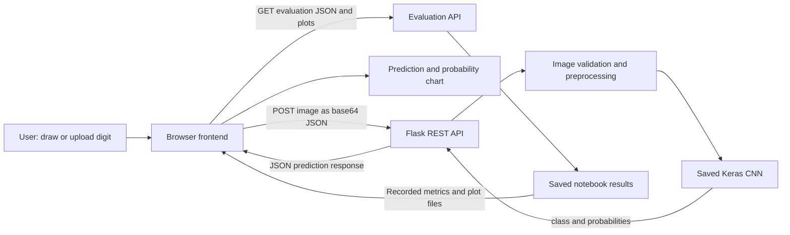

# MNIST Handwritten Digit Recognition

A full-stack machine-learning mini-project that recognizes handwritten digits
from 0 to 9. A browser-based drawing/upload interface sends images to a Flask
API, which preprocesses them and returns predictions from a trained Keras CNN.
The application also includes a separate evaluation report based on the
training notebook's saved metrics and plots.

## Abstract

This project investigates handwritten-digit classification using the MNIST
dataset. A dense artificial neural network (ANN) baseline is compared with two
convolutional neural network (CNN) designs. The selected CNN is saved and
served through a Flask REST API; a responsive frontend supports drawing or
uploading a digit and viewing its predicted class and class probabilities.
Notebook-generated evaluation results are presented separately from live
predictions so that model evaluation is not confused with an individual user
request.

## Objectives

- Build a working end-to-end digit-classification application.
- Compare a dense ANN baseline against two CNN configurations.
- Evaluate the selected model on the held-out MNIST test set using accuracy,
  macro precision, macro recall, macro F1, and a confusion matrix.
- Visualize training/validation curves and actual correct/misclassified
  examples from the test set.
- Keep the interactive prediction experience independent of the evaluation
  report.
- Document how to install, run, evaluate, and reproduce the project.

## Features

- Draw a digit on a browser canvas or upload a PNG/JPG/JPEG image.
- Predict one of ten digits and display the model's confidence and class
  probabilities.
- Preprocess uploaded images to an MNIST-style 28 x 28 grayscale input.
- View saved experiment metrics, model comparisons, learning curves, a
  confusion-matrix plot, and test-set prediction examples.
- See unavailable results explicitly where the saved notebook output did not
  record a metric; the report does not fill gaps with estimated values.
- Run the Flask backend and static frontend locally on Windows.

## Dataset

- **Dataset:** MNIST handwritten digits, classes 0-9.
- **Source:** The notebook loads MNIST using
  `tensorflow.keras.datasets.mnist.load_data()`. See the
  [Keras MNIST dataset documentation](https://keras.io/api/datasets/mnist/)
  and the [original MNIST database page](http://yann.lecun.com/exdb/mnist/).
- **Original split:** 60,000 training images and 10,000 test images.
- **Image format:** 28 x 28, single-channel grayscale; raw pixel values range
  from 0 to 255.
- **Experiment split:** The 60,000-image training partition is stratified into
  50,000 training and 10,000 validation images (seed 42). The original 10,000
  test images are held out for final evaluation.
- **Preprocessing:** Convert pixels to `float32`, divide by 255 to scale to
  `[0, 1]`, and add a channel dimension to obtain 28 x 28 x 1 tensors.
  For user-submitted images, the inference preprocessor also detects foreground
  polarity, crops around the digit, resizes it to fit within 20 x 20 pixels, and
  centers it on a 28 x 28 black canvas before normalization.

The notebook downloads the dataset through Keras the first time it runs; an
internet connection may be required if the dataset is not already cached.

## System architecture



The live prediction flow uses `backend\predict.py` and
`models\mnist_cnn.keras`. The report reads `results\evaluation.json` and
allowlisted plot files through separate evaluation endpoints. It does not
modify prediction history or claim the report metrics are live predictions.

### Project layout

```text
ML-MiniProject/
├── backend/
│   ├── app.py                 # Flask API routes
│   ├── predict.py             # Image preprocessing and model inference
│   └── requirements.txt       # Backend dependencies
├── frontend/
│   ├── index.html             # Digit recognizer and evaluation report
│   ├── script.js              # Prediction and evaluation UI
│   └── style.css              # Responsive styling
├── ml/
│   ├── train_model.ipynb      # Dataset preparation and ANN/CNN experiments
│   ├── export_evaluation.py   # Metrics and plot exporter
│   └── evaluate_model.py      # Standalone model evaluation utility
├── models/
│   └── mnist_cnn.keras        # Selected trained model (about 5.44 MiB)
├── results/
│   ├── evaluation.json        # Saved evaluation data
│   ├── training_curves.png
│   ├── confusion_matrix.png
│   └── predictions_analysis.png
├── tests/                     # API and evaluation exporter tests
├── .gitignore
├── requirements.txt
└── README.md
```

## ML methodology

The notebook trains and compares three models:

1. **Baseline ANN:** Flatten the 28 x 28 image, then use dense ReLU layers and
   dropout before the 10-class softmax output.
2. **CNN Config 1 (Standard):** Two convolution/max-pooling blocks followed by
   a dense classifier and dropout.
3. **CNN Config 2 (Deep + BN):** A deeper convolutional feature extractor with
   batch normalization and dropout, followed by a dense classifier.

CNN filters learn local spatial features such as strokes and edges. Pooling
reduces feature-map dimensions, while batch normalization helps stabilize
intermediate activations. Dropout is used to help reduce overfitting. The ANN
is a useful baseline, but flattening does not preserve the image's explicit
two-dimensional neighborhood structure in the same way as convolution.

The experiments use Adam with a 0.001 learning rate, sparse categorical
cross-entropy, batches of 128, and at most 20 epochs. Early stopping monitors
validation loss with patience 5 and restores the best weights. Seed 42 is used
for repeatable data splitting and initialization. The selected model is chosen
using validation performance; the held-out test set is reserved for final
evaluation.

## Actual evaluation results

The table below reports values recorded in the saved notebook run represented
by `results\evaluation.json`. Validation accuracy is the recorded accuracy at
the best validation-loss epoch. Test metrics are shown only for the selected
CNN because this saved run did not record test metrics for the other two
architectures.

| Model | Validation accuracy | Test accuracy | Macro precision | Macro recall | Macro F1 |
|---|---:|---:|---:|---:|---:|
| Baseline ANN | 98.06% | Unavailable | Unavailable | Unavailable | Unavailable |
| CNN Config 1 (Standard) | 99.08% | Unavailable | Unavailable | Unavailable | Unavailable |
| CNN Config 2 (Deep + BN), selected | 99.14% | 99.36% | 99.36% | 99.35% | 99.36% |

**Interpretation:** In the recorded validation comparison, both CNN
configurations performed better than the dense ANN baseline, and the deeper
CNN with batch normalization had the highest validation accuracy. Its recorded
test metrics are consistently about 99.35-99.36%, indicating strong and
balanced performance across digit classes on that test run. These results do
not establish how the other two models perform on the test set because their
test metrics were not saved in this run.

The existing saved output includes actual training/validation curves, a
confusion-matrix **plot**, and test-set examples labeled as correct or
misclassified. Numeric confusion-matrix cell counts were not retained in the
existing `evaluation.json`; they are therefore reported as unavailable rather
than reconstructed. Running all notebook cells again invokes the exporter,
which evaluates all three trained models and saves numeric confusion-matrix
counts for the new run.

## Installation on Windows

Open PowerShell in the project root. Python, Git, and VS Code (with the Python
and Jupyter extensions for notebook work) should be installed.

Create and activate a virtual environment, then install the project
dependencies:

```powershell
py -3 -m venv .venv
.\.venv\Scripts\Activate.ps1
python -m pip install --upgrade pip
python -m pip install -r requirements.txt
```

If PowerShell blocks activation, either allow script activation for the current
user according to your machine's policy or invoke the environment's Python
directly:

```powershell
.\.venv\Scripts\python.exe -m pip install -r requirements.txt
```

The root `requirements.txt` includes API, notebook, plotting, evaluation, and
test dependencies. To install only the API dependencies in an already
configured environment, use `python -m pip install -r backend\requirements.txt`.
TensorFlow installation support depends on the installed Python version and
platform; if installation fails, consult the
[official TensorFlow pip installation guide](https://www.tensorflow.org/install/pip).

## Train and reproduce the evaluation

1. From the project root, open `ml\train_model.ipynb` in VS Code and select the
   `.venv` interpreter/kernel.
2. Run all notebook cells. This downloads/loads MNIST, trains the ANN and both
   CNN configurations, selects a model using validation results, and evaluates
   the models on the held-out test data.
3. The final cell runs `ml\export_evaluation.py` and writes the new run's
   `results\evaluation.json` and plot artifacts. The notebook also saves the
   selected inference model to `models\mnist_cnn.keras`.
4. Restart the backend to load the newly saved model.

Training all three models can take time and uses CPU/GPU resources. Re-running
the notebook replaces the model and saved results. Record the run and
environment when submitting or comparing results. Saved metrics in this
repository describe the existing run; they should not be attributed to a later
run unless its artifacts have been regenerated.

## Run the backend and frontend

### Start the backend

In a PowerShell terminal at the project root:

```powershell
.\.venv\Scripts\Activate.ps1
python -m backend.app
```

The Flask API listens at `http://127.0.0.1:5000`. Confirm that the trained
model loaded by checking `http://127.0.0.1:5000/api/health`; the response should
report `"status": "healthy"` and `"model_loaded": true`.

### Start the frontend

In a second PowerShell terminal at the project root:

```powershell
.\.venv\Scripts\Activate.ps1
python -m http.server 5500 --directory frontend
```

Open `http://127.0.0.1:5500` in a browser. Keep both terminals running. By
default, the API permits local `localhost` and `127.0.0.1` frontend origins.
The frontend loads Chart.js from its CDN; the saved plot images remain
available if the CDN cannot be reached.

## API endpoints

The API defaults to `http://127.0.0.1:5000`.

| Method | Endpoint | Purpose |
|---|---|---|
| `GET` | `/` | Service and endpoint listing |
| `GET` | `/api/health` | Backend and model availability |
| `POST` | `/api/predict` | Predict one digit from a base64-encoded image |
| `GET` | `/api/evaluation` | Read saved evaluation JSON |
| `GET` | `/api/evaluation/artifacts/training_curves.png` | Training/validation curves |
| `GET` | `/api/evaluation/artifacts/confusion_matrix.png` | Confusion-matrix plot |
| `GET` | `/api/evaluation/artifacts/predictions_analysis.png` | Correct/misclassified examples |

### Prediction request (PowerShell)

Replace the example path with a PNG or JPEG image containing one digit:

```powershell
$imagePath = "C:\path\to\your-digit.png"
$imageBase64 = [Convert]::ToBase64String([IO.File]::ReadAllBytes($imagePath))
$requestBody = @{
    image = "data:image/png;base64,$imageBase64"
} | ConvertTo-Json

Invoke-RestMethod `
    -Uri "http://127.0.0.1:5000/api/predict" `
    -Method Post `
    -ContentType "application/json" `
    -Body $requestBody
```

The prediction response includes `prediction`, `confidence`,
`confidence_percentage`, and probabilities for digits 0 through 9. Invalid or
empty images are rejected with an error response. The API accepts JSON image
data and limits request payload size to 8 MB.

### Health and evaluation requests

```powershell
Invoke-RestMethod "http://127.0.0.1:5000/api/health"
Invoke-RestMethod "http://127.0.0.1:5000/api/evaluation"
```

Evaluation artifact URLs can be opened directly in a browser while the backend
is running. `MODEL_PATH` can be set to a different trained `.keras` file before
starting the backend; `ALLOWED_ORIGINS` can be set to a comma-separated list
when configuring a non-local frontend origin.

## Screenshots

No screenshots are included yet. Add genuine screenshots captured from the
running application before submission; do not use mockups or generated
placeholders as evidence.

- **Prediction interface:** save an actual application capture as
  `docs/screenshots/prediction-interface.png`.
- **Evaluation report:** save an actual application capture as
  `docs/screenshots/model-evaluation.png`.

After adding the files, embed them here with relative Markdown image links.

## Limitations and future scope

### Limitations

- MNIST consists of small, centered, grayscale digits; real-world handwriting,
  backgrounds, writing tools, and image quality can differ substantially.
- The saved historical run contains held-out test metrics only for the
  selected CNN. Test scores for the ANN and standard CNN are unavailable until
  a fresh notebook export evaluates and records them.
- Numeric confusion-matrix values were not saved for the existing run, even
  though its plot is available.
- Prediction quality depends on the user drawing or uploading one clear digit
  in a format that can be cropped and normalized.
- The project is configured and documented for local use; no public deployment
  is claimed.

### Future scope

- Add a labeled non-MNIST handwriting test set and measure generalization.
- Record per-class metrics and numeric confusion matrices for every model and
  run.
- Explore data augmentation, regularization, and additional architectures.
- Add evaluation-run metadata and versioning to make comparisons traceable.
- Improve input guidance and test preprocessing on a wider variety of images.
- Package and deploy the application with an explicitly configured production
  server and origin policy.

## Tests

From the project root with the virtual environment active:

```powershell
python -m pytest tests\test_api.py tests\test_export_evaluation.py -q
```

## Troubleshooting

- **Model not loaded / health returns 503:** Confirm that
  `models\mnist_cnn.keras` exists and is a valid Keras archive. If it is absent,
  run the notebook or set `MODEL_PATH` to the trained model before starting
  Flask.
- **Evaluation results unavailable:** Confirm that
  `results\evaluation.json` and the plot files exist. Run all notebook cells to
  generate fresh artifacts.
- **Frontend cannot reach the API:** Keep Flask running on port 5000, open the
  frontend over HTTP rather than `file://`, and check the browser console for
  CORS or network errors.
- **Port already in use:** Stop the other process using port 5000 or 5500, or
  configure a different backend `PORT`. For local development, update the
  local API port in `frontend/runtime-config.js` if the backend port changes.
- **Image rejected:** Use a valid, non-empty PNG or JPEG containing a clearly
  visible digit. Very large or blank images are rejected.
- **TensorFlow installation fails:** Check Python/platform support in the
  official TensorFlow install guide linked above and use a compatible Python
  environment.
- **Charts do not render:** Chart.js is loaded from a CDN; verify network
  access. The notebook-generated PNG plots do not require Chart.js.
- **Vercel build fails:** Set `MNIST_API_BASE_URL` in the Vercel Production
  environment to the Render HTTPS origin only, without an API path, query, or
  credentials; then redeploy.
- **Deployed API returns 503 / health check fails:** Inspect Render deploy
  logs, verify the checked-in model exists in the deployed commit, and confirm
  the selected instance has enough RAM. The health endpoint reports model
  load state and duration.
- **Deployed browser reports CORS errors:** Set Render `ALLOWED_ORIGINS` to
  the exact deployed Vercel origin(s), with no trailing slash, then redeploy
  the backend. Preview-deployment domains need to be added separately if used.
- **First API request is slow:** Render's free service may have spun down;
  allow its wake-up interval. Requests that time out or cause restarts can
  indicate insufficient instance memory or CPU.

## Online deployment (Vercel frontend + Render API)

The repository includes [`vercel.json`](./vercel.json), a build-time frontend
configuration script, and [`render.yaml`](./render.yaml) for deployment
preparation. The frontend gets its API base URL from `MNIST_API_BASE_URL` at
Vercel build time. Localhost detection exists only in the local runtime
configuration; the production build requires an absolute HTTPS backend origin.
The model archive is tracked in Git and is loaded from `models/mnist_cnn.keras`
when the Flask/Gunicorn application starts.

### Deploy the Flask backend to Render

1. Push this repository and the tracked model file to GitHub.
2. In Render, create a **Blueprint** from the repository and review
   `render.yaml`. It specifies Python 3.12.1, installs
   `backend/requirements.txt`, starts one Gunicorn worker, and checks
   `/api/health`.
3. Set the Render service environment variable `ALLOWED_ORIGINS` to the exact
   Vercel production origin, for example
   `https://your-project.vercel.app` (no path or trailing slash). If you use a
   custom frontend domain, include that exact origin too, comma-separated.
4. Deploy and wait until the Render health check reports healthy. Use the
   `.onrender.com` URL assigned by Render as the backend origin; do not paste a
   placeholder into the frontend.

The production start command is:

```sh
gunicorn --bind 0.0.0.0:$PORT --workers 1 --threads 1 --timeout 120 backend.app:app
```

Render runs the app on Linux. The model is included in the repository
(currently 5,708,170 bytes / 5.44 MiB), so it is present in the checkout at
startup; no external model download or persistent disk is required. The
Blueprint sets TensorFlow intra/inter-op thread counts to one to reduce CPU and
memory pressure. Keep a single worker: each additional worker loads another
TensorFlow runtime and model into memory.

### Deploy the static frontend to Vercel

1. Import the same GitHub repository into Vercel, with the repository root as
   the project root. `vercel.json` selects static output in `frontend/`.
2. Add the environment variable `MNIST_API_BASE_URL` for the **Production**
   environment using the actual Render backend origin, such as
   `https://your-service.onrender.com` (origin only; no `/api` suffix).
3. Deploy. The build command validates HTTPS and writes the production URL into
   `frontend/runtime-config.js` in the build output. Redeploy after changing
   this environment variable.
4. Copy the actual Vercel production origin into Render's `ALLOWED_ORIGINS`
   setting and redeploy the backend if needed.

### Validate the deployment

Do not call the app deployed until these requests succeed against the assigned
provider URLs:

```powershell
$api = "https://YOUR-ACTUAL-SERVICE.onrender.com"
Invoke-RestMethod "$api/api/health"
Invoke-RestMethod "$api/api/evaluation"
```

The health response should contain `status: healthy`, `model_loaded: true`,
`model_size_bytes`, and `model_load_seconds`. For an end-to-end prediction,
open the deployed Vercel URL, draw a digit, and select **Predict digit**. Check
that the browser network panel shows a successful `POST /api/predict`, a digit
and probabilities appear, and the console has no CORS/network errors. You can
also send a real image file with the PowerShell API example above, substituting
the deployed API URL. A successful health check alone does not verify
prediction or CORS from the deployed frontend.

### Resource, compatibility, and cost notes

- **Model archive:** 5.44 MiB. The Keras `.keras` archive is committed to Git so
  Render receives it during deploy. Check repository/Git provider limits again
  if the model is replaced or grows.
- **Python dependencies:** backend requirements bound Flask, Flask-CORS,
  TensorFlow (`>=2.16,<2.21`), NumPy (`>=1.26,<2.2`), Pillow, and Gunicorn.
  This avoids TensorFlow/NumPy 2.2+ incompatibility and keeps Python 3.12 in
  the supported deployment range. Confirm the final dependency resolver/build
  log in Render after every dependency change.
- **Memory and cold start:** TensorFlow's runtime requires substantially more
  memory than the 5.44 MiB model file. On this Windows development machine,
  Python 3.12.1 / TensorFlow 2.20.0 cold Python import plus app/model startup
  took 15.6-20.6 seconds; loading the model itself took 0.77-1.20 seconds, and
  observed process peak RSS was 360-370 MiB through one prediction. These are
  local measurements, not Render measurements. Use one worker. The health
  endpoint exposes model-load duration; measure peak RSS and cold-start
  latency on the selected Render instance after deployment. If its memory
  limit leaves little headroom, logs show OOM/restarts, or health checks time
  out, use a larger paid instance or another platform with enough RAM.
- **Render free service:** currently free web services spin down after 15
  minutes without traffic, may take about a minute to wake, have ephemeral
  storage, and share a 750 free-instance-hour monthly workspace allowance.
  They can be restarted or suspended when limits are reached; suitable for
  demos, not production reliability. Recheck current quotas, RAM/CPU, outbound
  bandwidth, and pricing before selecting a plan.
- **Vercel Hobby:** currently free for personal projects with monthly usage
  limits. Confirm current eligibility, transfer/build/request quotas, and plan
  terms in your account before deployment.
- **Costs change:** no paid resources are required by this repository
  configuration, but free-tier availability and limits can change. Check
  provider dashboards and official [Render free service
  limitations](https://render.com/docs/free),
  [Render compute plans and pricing](https://render.com/docs/compute-plans),
  [Render pricing](https://render.com/pricing), and
  [Vercel Hobby plan](https://vercel.com/docs/plans/hobby) before use.

## References

1. Yann LeCun, Corinna Cortes, and Christopher J.C. Burges,
   [The MNIST Database of Handwritten Digits](http://yann.lecun.com/exdb/mnist/).
2. Keras,
   [MNIST dataset API](https://keras.io/api/datasets/mnist/).
3. TensorFlow,
   [Install TensorFlow with pip](https://www.tensorflow.org/install/pip).
4. Flask,
   [Flask documentation](https://flask.palletsprojects.com/).
5. Chart.js,
   [Chart.js documentation](https://www.chartjs.org/docs/latest/).

## Prepare and push this project to GitHub

The trained model is **5,708,170 bytes (5.44 MiB)**, measured from
`models\mnist_cnn.keras`. This is below GitHub's 100 MiB per-file limit, and
`.gitignore` explicitly allows this project model to be added. The virtual
environment, Python caches, local secrets, and temporary files are ignored.
Review the staged-file list before committing, especially if you regenerate
large notebook outputs or add other data files.

If Git is not initialized yet, create an empty repository on GitHub first
(without generating a second README), then run these commands from the project
root. Replace the remote URL with the URL of your own GitHub repository:

```powershell
git init -b main
git status --short
git add -A
git status
git diff --cached --stat
git commit -m "Prepare MNIST project for submission"
git remote add origin "https://github.com/YOUR_USERNAME/YOUR_REPOSITORY.git"
git push -u origin main
```

If a remote named `origin` already exists, inspect it with
`git remote -v` and update it with
`git remote set-url origin "YOUR_GITHUB_REPOSITORY_URL"`
instead of adding it again. Do not commit passwords, API tokens, private keys,
or other credentials. GitHub authentication should use Git Credential Manager
or an SSH key configured on your own machine; never place a credential in this
README or the remote URL.
